# System QuikView gallery

## Marketplace cover and native demos — 0.4.7, 19 October 2026

The root `preview.png` is a promotional one-sheet in the same visual family as OmaChat and OmaDroid. OpenAI's built-in image generation produced the composition from native 0.4.7 QML captures with invented readings. It is promotional artwork, not a pixel-exact screenshot or a claim that every sensor is available on every machine. [Generation prompt](artwork/marketplace-cover-prompt.txt).

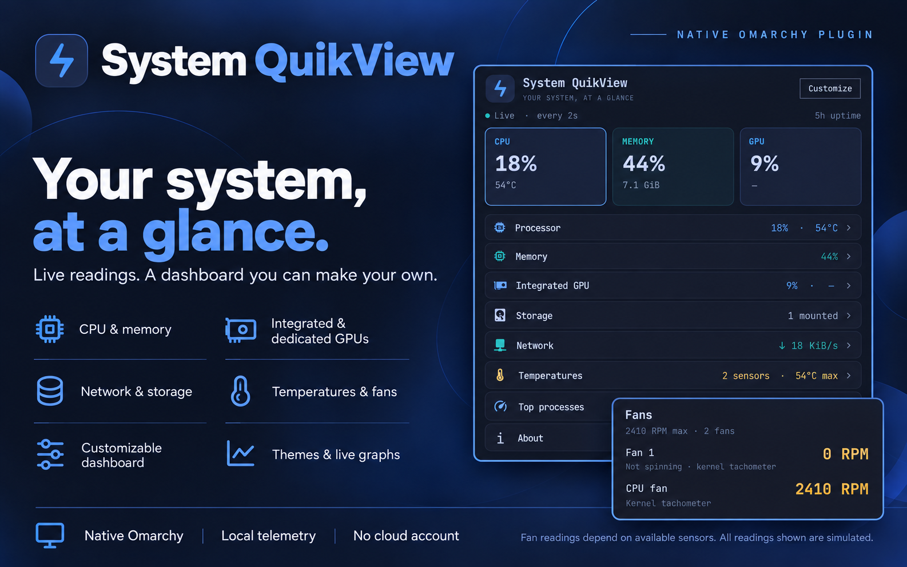

These unedited native captures use an isolated collector stub, synthetic readings and the real current panel. No user telemetry or installed plugin was used or changed. The dark fan card shows simulated kernel RPM, including a true stopped-fan zero; the light card shows a simulated publisher duty estimate, not RPM. The overview intentionally collapses sections; its integrated GPU has shared system memory and no dedicated VRAM. Captured on Omarchy 4.0.5, Quickshell 0.3.2 and Qt 6.12.

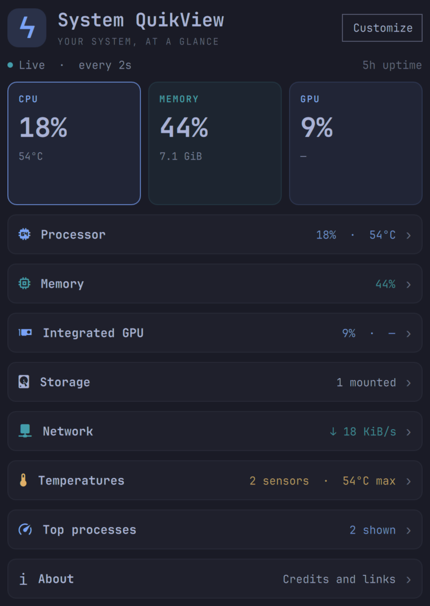
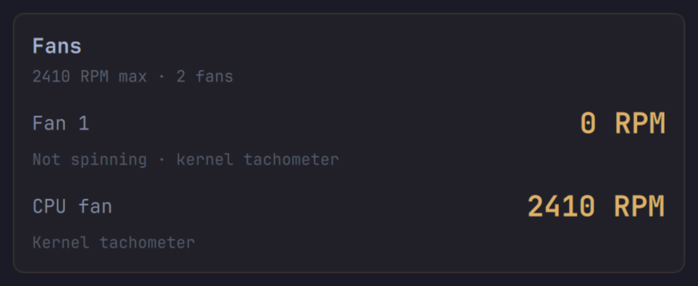
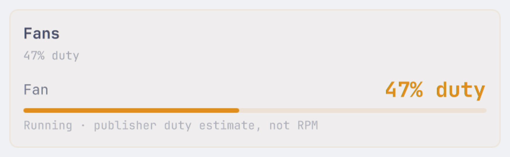

## Earlier gallery

Real screenshots from Omarchy Shell, using live readings from an AMD integrated / NVIDIA dedicated laptop. Sections are collapsed and reordered to highlight each view; all of these controls are available in Customize. Longer views scroll.

## Overview

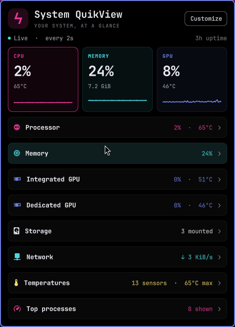

## Make it yours

Move sections individually and choose the reading in your bar. GPU source selection and role overrides are farther down the settings view.

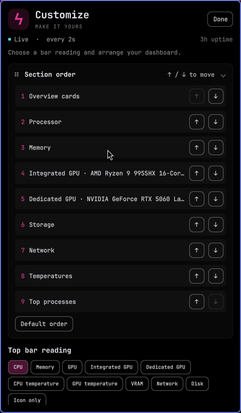

## Network

Independent download and upload histories, recent peaks, and per-interface counters. Inactive interfaces can be revealed when needed.

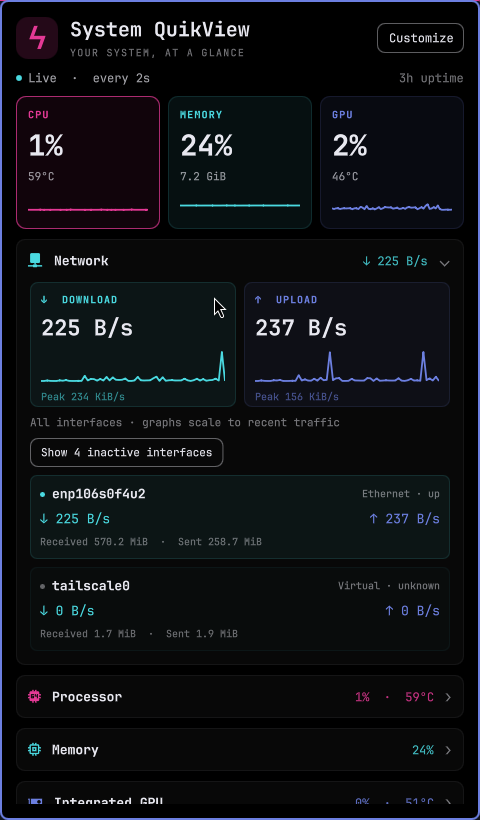

## Temperatures

Device groups keep sensor names, current readings, and hardware limits together. This capture shows the top of the scrollable temperature section.

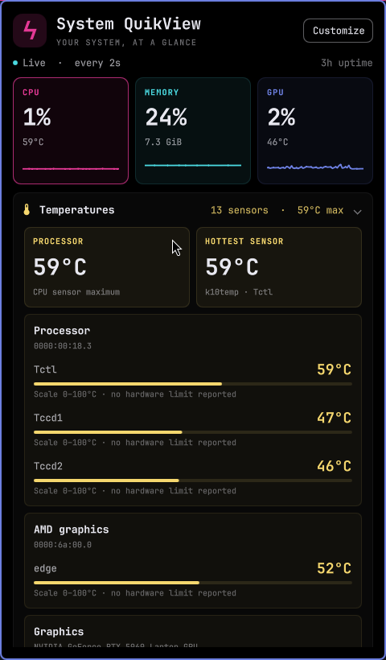

## Top processes

Ranked process cards pair CPU usage with resident memory. The two comparison bars use separate scales.

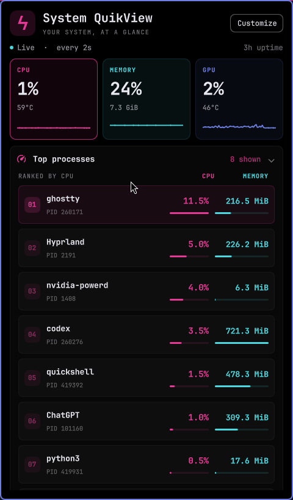

## Dark and light themes

These are captures after applying each installed Omarchy theme. QuikView reads the active palette automatically.

| Catppuccin | Gruvbox | Catppuccin Latte |
| --- | --- | --- |
| 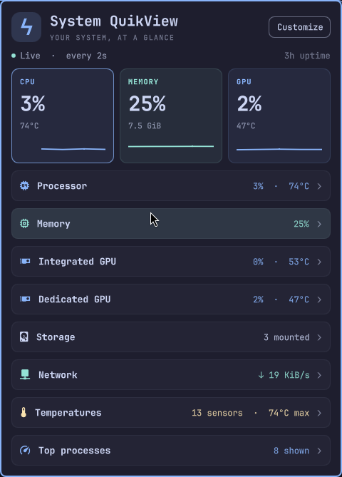 | 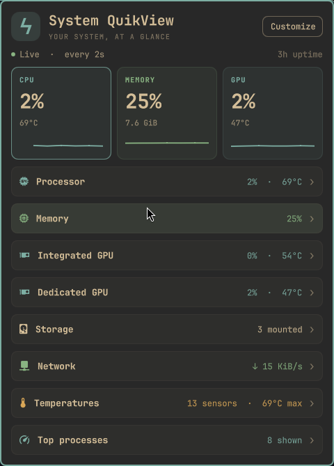 | 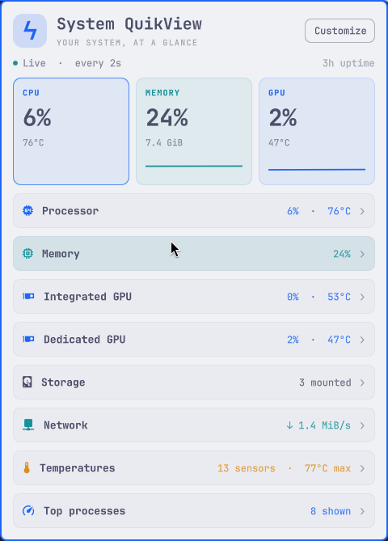 |

[Back to installation and features](../README.md)
